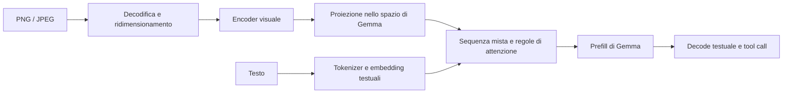

# Piano per la vision in Xenolith

Stato: encoder nativo, prima risposta CLI, persistenza e protocollo multimodale
implementati sulla Lunar Lake, 14 ottobre 2026. Sessioni a 64k e 128k verificate;
regressioni e benchmark conclusivi documentati in `vision/VALIDATION.md`.
La latenza dell'encoder a 1120 rimane sperimentale. Xenopi richiede
l'adattamento del client al protocollo v2. Base Xenolith esaminata:
`36a4c12cdf75bbfb05426233dae54037ba1d6641`.

## Obiettivo e prima versione

Consentire a Gemma 4 26B-A4B IT QAT di rispondere a messaggi contenenti immagini
e testo, mantenendo conversazioni, streaming, tool calling e ripristino.
L'output rimane testuale. Il primo caso pratico è uno screenshot accompagnato
da una domanda, seguito da altre domande sulla stessa immagine.

Scelte concordate per la prima versione:

- Modello linguistico GGUF attuale, più un `mmproj` compatibile, caricato
  esplicitamente; vision opzionale.
- PNG e JPEG statici, convertiti in RGB con regole documentate per trasparenza
  e orientamento. Percorso CLI e API C prima del protocollo.
- Una immagine per messaggio, anche in più turni successivi. Messaggi utente e
  risultati di tool possono contenere immagini. La rappresentazione interna
  ammette già una sequenza ordinata di parti testuali e visuali.
- Contesti iniziali di 65.536 e 131.072 elementi (64k e 128k).
- Blocchi visuali di lunghezza variabile fino a 1120 elementi; budget
  70/140/280/560/1120, separando testo e immagini quando necessario.
- Padding ammesso solo come righe di calcolo ignorate: non entra nei token,
  nelle posizioni RoPE, nella KV, nei conteggi o nella persistenza.
- Dati necessari all'attenzione dell'intera immagine disponibili nei buffer
  temporanei per ciascun layer; commit locale solo degli ultimi 1024 elementi.
- Percorso testuale a 512 conservato; confronto controllato con 1024, senza
  cambiare automaticamente il default.
- Inferenza nativa C / Level Zero. Python e llama.cpp servono come riferimenti
  di verifica, senza diventare dipendenze del percorso di produzione.
- Supporto completo a cronologia, replay, rewind e checkpoint prima di
  dichiarare vision disponibile ai client.

Più immagini nello stesso messaggio e video vengono dopo la prima certificazione. Una prima demo da CLI può precedere la versione
utilizzabile nelle sessioni, ma non sostituisce questi requisiti.

## Come arriva un'immagine al modello

Gli embedding sono vettori numerici. Quelli visuali rappresentano il contenuto
dell'immagine e occupano posizioni nel contesto, come quelli dei token testuali.
Non si ottengono passando il nome del file o la sua codifica Base64 al tokenizer.

Il modello target ha un encoder visuale di circa 550 milioni di parametri.
Il `mmproj` distribuito insieme al GGUF contiene i pesi del percorso visuale,
non soltanto una piccola matrice di collegamento. Fonti:
[model card Google](https://ai.google.dev/gemma/docs/core/model_card_4) e
[distribuzione Unsloth](https://huggingface.co/unsloth/gemma-4-26B-A4B-it-qat-GGUF/tree/main).

## Scelte di architettura

### Encoder e preprocessing

Servono decodifica, ridimensionamento coerente con il riferimento, patch,
coordinate spaziali, encoder, pooling e proiezione. Il resize conserva le
proporzioni e dipende dal budget visuale. Per i dettagli del checkpoint QAT
vanno letti i metadati reali del `mmproj`, incluse eventuali operazioni di
clipping. Non assumere che sia intercambiabile con un encoder Gemma 3 o con
un'altra variante Gemma 4.

Riferimenti:
[processor immagini Transformers](https://github.com/huggingface/transformers/blob/main/src/transformers/models/gemma4/image_processing_gemma4.py),
[configurazione del checkpoint QAT](https://huggingface.co/unsloth/gemma-4-26B-A4B-it-qat-GGUF/blob/main/config.json),
[encoder llama.cpp](https://github.com/ggml-org/llama.cpp/blob/master/tools/mtmd/models/gemma4v.cpp).

### Prefill e attenzione

`xe_prefill_batch_append_run()` conserva `xe_embed_decode()` per il testo
e inserisce direttamente le righe visuali già proiettate, senza applicare
nuovamente la scala degli embedding testuali.

Il target usa attenzione bidirezionale entro i blocchi visuali sui layer
locali, con il vincolo della finestra; i layer globali rimangono causali.
La semantica precisa, compresi delimitatori e appartenenza ai blocchi, deve
essere riprodotta dal processor del riferimento.
Fonte: [maschere Gemma 4 in Transformers](https://github.com/huggingface/transformers/blob/main/src/transformers/models/gemma4/modeling_gemma4.py).

Il percorso originale limitava le chiavi alla posizione della query e
`xe_session_extend()` spezzava il prefill ogni 512 posizioni: un blocco visuale
non può essere tagliato arbitrariamente, perdendo accesso alle sue posizioni
successive. Anche un'immagine sotto 280 posizioni può attraversare quel
confine se segue molto testo.

Scelta: segmentare il prefill ai confini delle immagini ed elaborare ogni
blocco visuale completo fino a 1120 elementi, usando un percorso dedicato.
Preparare K/V per tutto il blocco prima dell'attenzione, consentendo tile di
calcolo senza tagliare le dipendenze. Il ring SWA si aggiorna dopo aver usato
i dati temporanei, conservando solo gli ultimi 1024 elementi: ogni slot deve
avere una sola scrittura, anche quando il blocco supera la finestra. Il decode dopo il prompt continua a produrre token testuali.

### Identità del contesto e persistenza

Il riuso del prefisso e l'hash dello snapshot originariamente confrontavano
soltanto gli ID dei token. Due immagini diverse con lo stesso numero di segnaposto
avrebbero la stessa sequenza di ID. Riutilizzare quella cache darebbe risultati
errati.

L'identità di un segmento visuale deve includere contenuto dell'immagine,
budget, revisione del preprocessing, pesi visuali e convenzione numerica.
Questo vale anche per shadow session, COW, rewind e ricostruzione della storia
quando cambia il trattamento del reasoning.

I confini dentro un blocco visuale non sono automaticamente riutilizzabili:
alcune righe già calcolate possono dipendere da righe successive dello stesso
blocco. Nella prima versione rewind e checkpoint devono usare confini validi;
una modifica dentro un'immagine invalida il blocco a partire dal suo inizio.

## Architettura implementata

| Componente | Responsabilità |
|---|---|
| Nuovi `vision.c/.h` e kernel visuali | Lettura pesi, encoder, proiezione, buffer e diagnostica. |
| Nuovo modulo immagini | PNG/JPEG, RGB, resize, patch e limiti prima delle allocazioni. |
| `xenolith.c`, API pubblica e interna | Sequenza mista, prefill visuale, maschere, identità del prefisso e snapshot. |
| `profile.c/.h` | Parti ordinate, delimitatori del modello e mappa delle posizioni visuali. |
| `runtime.c/.h` | Preparazione immagini, contabilizzazione del contesto, replay e generazione. |
| `conversation.c/.h`, `kvstore.c/.h` | Dati visuali persistenti, compatibilità dei formati e invalidazione cache. |
| `serve.c`, `PROTOCOL.md` | Capacità vision, messaggi multimodali, trasporto e recupero dei contenuti. |
| `main.c`, `Makefile` | Opzioni `mmproj`/immagine, compilazione e verifiche. |

La sequenza interna deve distinguere token testuali e span visuali con offset,
lunghezza, embedding e identità. Non basta aggiungere un puntatore a un'immagine
al messaggio e conservare il confronto del prefisso attuale.

`conversation_block` conserva i media binari in un tipo immagine esplicito.
Il runtime ricostruisce la sequenza mista dai blocchi e dai metadati persistenti;
i lettori validano il formato prima di modificare la sessione.

Il decoder PNG/JPEG è `stb_image`, importato con versione/hash e licenza.
Il mmproj scelto usa pesi F16 e parametri di normalizzazione/posizione F32;
accumuli e passaggi sensibili restano F32. Il loader è vincolato a questi
tipi e a questo checkpoint: mmproj BF16 o quantizzati diversi non sono supportati.
Pooling e standardizzazione meritano verifiche specifiche su valori estremi.

## Piano per incrementi verificabili

La prima milestone è una risposta verificata da CLI. Seguono misure su
Lunar Lake e supporto completo alle sessioni. Preparazione e identificazione
dei pesi precedono l'implementazione, già autorizzata dall'utente.

| Fase | Risultato concreto | Criterio per procedere |
|---|---|---|
| 0. Specifica e riferimento | Manifesto modello/`mmproj`, versioni bloccate, inventario tensori, immagini e dump di riferimento, contratto delle sequenze e dei formati. | Dimensioni, token, resize, maschere e compatibilità del checkpoint sono verificati. |
| 1. Encoder isolato | Preprocessing C e implementazione di riferimento, caricamento visuale, comando che esporta embedding. | Confronto di pixel/patch, intermedi e embedding con riferimento esterno; nessun valore non finito. |
| 2. Prima risposta da CLI | Sequenza mista, embedding nel prefill e attenzione visuale corretta. | Logits e risposte su immagini fisse; casi a cavallo delle 512 posizioni e dei confini SWA; regressioni testuali superate. |
| 3. Prestazioni visuali | Matrici dense e attenzione su iGPU, memoria di lavoro limitata, profilo per fase. | Parità numerica con la baseline e misure sul dispositivo target. |
| 4. Sessioni multimodali | Persistenza immagini, replay, prefissi, rewind, shadow/COW e checkpoint. | Riavvio e cache eviction riproducono il contesto; immagini diverse non condividono cache per errore. |
| 5. Protocollo e rilascio | Capacità pubblicate, append/rebuild/ephemeral/history multimodali, limiti ed errori documentati. | Client minimo end-to-end, compatibilità testuale, sessioni recuperabili e documentazione d'uso. |

La baseline CPU della fase 1 serve alla correttezza e ai test, non è una
promessa di latenza accettabile. La fase 2 può usare un percorso visuale lento;
la fase 3 porta l'encoder al livello necessario per il rilascio. Le regole di
identità e persistenza si progettano dalla fase 0, anche se si implementano
integralmente nella fase 4.

### Fase 0: preparazione completata prima dell'implementazione

1. Selezionare il `mmproj` della distribuzione QAT, bloccare revisione e SHA-256
   di entrambi i file. Validare architettura, dimensione di proiezione e tipi;
   la sola compatibilità dimensionale non garantisce la provenienza corretta.
2. Bloccare anche i riferimenti software. La copia locale di llama.cpp
   esaminata è `ce7dffccee2bbef897bfc0820dc378c087a1aed7`.
3. Esportare fixture di preprocessing e encoder da un riferimento esterno;
   confrontare il modello quantizzato completo con llama.cpp, dopo aver
   verificato che le sue maschere corrispondano alla semantica Transformers.
   Risolvere eventuali divergenze anziché scegliere il risultato più conveniente.
4. Definire API della sequenza mista, identità del prefisso, confini validi e
   versioni dei formati. Approvare tecnicamente queste scelte prima del loader.
5. Selezionare decoder immagini, gestione alpha/orientamento, limiti di byte,
   pixel, posizioni visuali e memoria temporanea. Misurare un primo riferimento
   sul laptop target per poter stimare lavoro e prestazioni con dati reali.

## Protocollo: migrazione implementata

La prima versione conserva `text` e aggiunge un campo `image` nei messaggi
utente e nei risultati dei tool: una immagine per messaggio. Internamente usa
span ordinati con offset espliciti. `describe` annuncia vision solo quando
il mmproj è caricato e il contesto è 64k o 128k.

`wire` e `serve --mmproj FILE` selezionano il protocollo v2 all'avvio; senza
mmproj rimane v1. Il client deve leggere le capacità dichiarate prima di
inviare contenuti visuali. Il contratto completo è in `PROTOCOL.md`.

Per il primo trasporto, Base64 inline con limiti espliciti è sufficiente se
validato contro il frame massimo; le immagini vengono conservate in binario
nel transcript o in uno store di media durevole. Il limite del frame visuale
è indipendente dal numero di token del contesto: v2 usa un massimo di
96 MiB, con un limite di 48 MiB per i media originali.

La cronologia può esporre metadati e riferimenti stabili ai media, con un modo
documentato per recuperarli e usarli nel rebuild. Deve essere possibile
ricostruire la sessione dopo la perdita degli snapshot. Il solo percorso
originale sul filesystem non è un dato persistente sufficiente. Lo stesso
vale per gli embedding se non si conserva come riprodurli.

Le allocazioni e i limiti devono essere verificati prima di modificare la
sessione. Input corrotto, `mmproj` incompatibile, contesto insufficiente o
risorse insufficienti producono errori espliciti. Progressi di preparazione
visuale vanno distinti da prefill e decode, per rendere comprensibile la latenza.

## Verifiche e misure

- Fixture: immagini quadrate, larghe e alte; screenshot con testo; PNG con
  alpha; JPEG orientato; file troncati; dimensioni estreme.
- Numerica: preprocessing, uno o più layer visuali, proiezione, maschere,
  logits e decode. Tolleranze fissate prima delle ottimizzazioni in base ai
  tipi e agli errori misurati; una descrizione plausibile non certifica il motore.
- Contesto: immagini a inizio/fine batch, confini 511/512/513, wraparound SWA,
  più turni, stessa immagine con budget diverso e immagini diverse con uguale
  numero di posizioni. Per 560/1120, verificare visibilità tra tile.
- Sessioni: snapshot, replay senza snapshot, riapertura dopo riavvio, rewind,
  rebuild, tool result visuale, cancellazione ed errori senza commit parziali.
- Regressioni: suite host, GPU e modello già presenti, sui dispositivi Linux
  supportati. Il fingerprint numerico del Makefile include i nuovi sorgenti
  e kernel visuali.
- Prestazioni: tempo decode immagine, preprocessing, encoder, prefill LLM,
  primo token, decode testuale, RSS e memoria GPU di picco. Misurare anche
  sessioni lunghe e riuso; non confondere il costo dell'encoder con token/s LLM.

Il `mmproj` F16 distribuito occupa circa 1,19 GB su disco, da aggiungere al
modello testuale; questa cifra non rappresenta il consumo totale di RAM.
Gli embedding finali F32 da 1120 posizioni e 2816 componenti occupano circa
12 MiB. I pesi, le attivazioni dell'encoder e la KV cache sono i costi maggiori.
L'attenzione visuale deve evitare grandi matrici dense di score residenti
quando si aumenta il budget. La fattibilità nei 32 GB va verificata sul target.

Le prime misure sono diagnostiche. A 1120 l'encoder iniziale ha ancora una
latenza elevata; prima di ottimizzarlo, conservare i dump verificati come
riferimento e misurare separatamente startup, encoder, prefill e decode.

## Memoria e baseline concordate

Workspace di prefill calcolato dal codice: circa 212 MiB a 512 righe,
417 MiB a 1024 e 455 MiB a 1120. Esclude pesi, workspace e attivazioni
dell'encoder visuale. WSL dispone di circa 27,41 GiB totali secondo la lettura
SSH riportata dall'utente; Xenolith non era attivo durante quella lettura.
Questa misura non prova la residenza GPU con modello e vision caricati.

Le note locali descrivono divergenze CPU/GPU già presenti e differenze rispetto
a llama.cpp. Registrare baseline e candidate con stessi pesi, input, contesto,
thread e configurazione; conservare logits, distribuzioni e continuazioni.
Non aumentare le soglie per far passare le modifiche. Misurare regressioni
rispetto alla baseline separatamente dalla correttezza rispetto al riferimento.
Benchmark pp512/pp2048/pp8192, tg128, prefill testuale 512 contro 1024, vision
a tutti i budget, latenza primo token, throughput e memoria/residenza WSL.

Pesi e riferimenti sono bloccati in `vision/manifest.json`. Il loader verifica dimensione e SHA-256 del mmproj; l'abilitazione vision
verifica anche il SHA-256 completo del modello linguistico. Questo hash viene
calcolato una volta per engine e non modifica il percorso testuale. I valori
reali di entrambi i file sono già stati verificati sulla macchina target.

## Stato dell'implementazione

- `vision.c/.h`: PNG/JPEG, EXIF, alpha su bianco, resize, inventario e loader
  bloccato al checkpoint selezionato; identità, sequenza mista e archivio media.
- `vision.cl`: encoder a 27 layer e proiettore F16/F32 nativi Level Zero,
  senza matrice completa degli score residenti.
- `vision_gpu.inc` / `xenolith.c`: span interi fino a 1120, scratch visuale,
  commit degli ultimi 1024, FFN in tile da 512 e default testo conservato.
- `profile.c`, `main.c`: delimitatori reali, `vision-encode`, `run --image`
  e `chat --image` con un allegato iniziale e domande successive,
  con filtraggio dei canali del modello e dump numerici opzionali.
- Primitive C delle sessioni: copie possedute, prefissi con immagini, append
  conservando KV compatibile, replay, rewind ai confini, shadow/COW e snapshot
  visuali v2.
- Runtime/conversation/kvstore: media originali persistenti, cache embeddings
  ricostruibile e limitata a 2 GiB, mappa visuale aggiornata dopo le proiezioni
  della cronologia, riavvio e ripristino degli snapshot.
- Protocollo v2 opzionale: append/rebuild/ephemeral/history e recupero dei
  media via SHA-256, con limiti espliciti; percorso v1 testuale conservato.
- Riferimenti: pixel Pillow/HF, encoder NumPy indipendente, encoder e decoder
  llama.cpp al commit bloccato. Nessuno è una dipendenza di produzione.

Il GGUF selezionato omette `clip.use_gelu`: il riferimento llama.cpp sceglie
QuickGELU per default, mentre la configurazione del checkpoint prescrive
GELU-tanh. `tools/vision_reference.cpp` seleziona esplicitamente `FFN_GELU`;
manifesto e risultati documentano questa correzione. Inoltre ggml CPU usa
normalmente una tabella GELU F16 anche per intermedi F32: l'oracle allineato
disabilita quella scorciatoia in una copia isolata e identificata tramite hash.
Il confronto con NumPy indipendente conferma l'encoder F32. Le soglie numeriche
(RMS relativo <= 0,005, coseno >= 0,99998 per l'encoder) restano invariate.

Le verifiche end-to-end a 64k e 128k hanno superato risposta, seconda immagine,
rewind, checkpoint, riapertura dopo riavvio, eviction, ephemeral, rebuild e
tool result visuale. Il replay visuale del runtime resta sincrono; l'ottimizzazione
shadow asincrona è disabilitata per i prompt con immagini, mentre le primitive
C di shadow/COW rimangono disponibili. Prima di una certificazione ampia servono prove
su screenshot/OCR e immagini reali: le fixture di quadranti verificano il
percorso visuale, ma non misurano la qualità generale della comprensione.
I risultati misurati e i comandi di riproduzione sono raccolti in
`vision/VALIDATION.md`; i valori README dell'HP i7-13700H restano separati.
